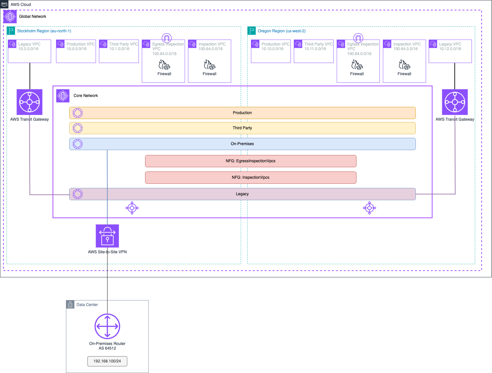

# AWS Cloud WAN - CloudFormation

AWS Cloud WAN is a managed wide-area networking (WAN) service that you can use to build, manage, and monitor an unified global network that connects resources running across your cloud and on-premises environments. It provides a central dashboard from which you can connect on-premises branch offices, data centers, and Amazon Virtual Private Clouds (VPCs) across the AWS global network. You can use simple network policies to centrally configure and automate network management and security tasks, and get a complete view of your global network.

This repository shows you an example in AWS CloudFormation of global communication with AWS Cloud WAN, showing the same architecture you can build in the [AWS Cloud WAN Workshop](https://catalog.workshops.aws/cloudwan/en-US).



**NOTE**: The resources created incur costs in your AWS Account. Consider deleting the resources created once your tests are done. For more information, check the [AWS Cloud WAN pricing](https://aws.amazon.com/cloud-wan/pricing/).

## Deployment instructions

- Clone the repository
- If you want to follow the [workshop instructions](https://catalog.workshops.aws/cloudwan/en-US), move to the [Following the lab instructions](#following-the-lab-instructions) section.
- If you want to test out the code outside the lab instructions, check carefully each stack and the resources it deploys:
  - `Workloads.ts` creates the spoke VPCs.
  - `Inspection.ts` creates both Inspection VPCs (egress and east-west).
  - `Legacy.ts` creates the legacy infrastructure with Transit Gateway.
  - `onpremises.ts` creates the _mock on-premises_ in eu-west-2 (London).
  - `vpn.ts` creates the VPN connection resources in eu-nort-1 (Stockholm).

## Following the lab instructions

**NOTE**: The final state of both workshop labs is codified in this repository. However, some pieces are commented or only deployed if specific parameters are configured. Check below to understand how to deploy the environment for each different state.

### Lab 1 - Build a global, segmented network with central egress

1. If you want to follow the lab guide:

- `npm run deploy -- --deployment initial` to build the initial environment.
- `npm run deploy -- --deployment initial --profile profile_name` If you use named CLI profiles

2. If you want to build the end architecture after finishing the steps:

- Execute `npm run deploy -- --deployment lab1`.
- `npm run deploy -- --deployment lab1 --profile profile_name` If you use named CLI profiles

Clean-up the test environment and avoid undesired charges.

- `npm run destroy`
- `npm run destroy -- --profile profile_name` If you use named CLI profiles

### Lab 2 - Federate with AWS Transit Gateway

1. If you want to follow the lab guide:

- `npm run deploy -- --deployment lab1` to build the environment.
- `npm run deploy -- --deployment lab1 --profile profile_name` If you use named CLI profiles
- Follow [Step 6](https://catalog.workshops.aws/cloudwan/en-US/3-labs/lab1/step-6) in the workshop guide to configure the VPN connection.

2. If you want to build the end architecture after finishing the steps:

- Execute `npm run deploy -- --deployment lab2`.
- Execute `npm run deploy -- --deployment lab2 --profile profile_name` If you use named CLI profiles

Clean-up the test environment and avoid undesired charges.

- `npm run destroy`
- `npm run destroy -- --profile profile_name` If you use named CLI profiles

### Lab 3 - Additional inspection scenarios

- `npm run deploy -- --deployment lab2` to build the initial environment.
- `npm run deploy -- --deployment lab2 --profile profile_name` If you use named CLI profiles

2. If you want to build the end architecture after finishing the steps:

- Execute `npm run deploy -- --deployment lab3`.
- Execute `npm run deploy -- --deployment lab3 --profile profile_name` If you use named CLI profiles

```yaml
CoreNetwork:
  Type: AWS::NetworkManager::CoreNetwork
  Properties:
    Description: Core Network - AWS Cloud WAN workshop
    GlobalNetworkId: !Ref GlobalNetwork
    Tags:
      - Key: Name
        Value: core-network-cwan-workshop
    PolicyDocument:
      version: "2021.12"
      core-network-configuration:
        vpn-ecmp-support: false
        asn-ranges:
          - 64520-65525
        edge-locations:
          - location: eu-north-1
          - location: us-west-2
      segments:
        - name: prod
          require-attachment-acceptance: false
          edge-locations:
            - eu-north-1
            - us-west-2
        - name: thirdparty
          isolate-attachments: true
          require-attachment-acceptance: false
          edge-locations:
            - eu-north-1
            - us-west-2
        - name: onpremises
          require-attachment-acceptance: false
        - name: legacy
          require-attachment-acceptance: false
          edge-locations:
            - eu-north-1
            - us-west-2
      network-function-groups:
        - name: EgressInspectionVpcs
          require-attachment-acceptance: false
        - name: InspectionVpcs
          require-attachment-acceptance: false
      attachment-policies:
        - rule-number: 100
          condition-logic: or
          conditions:
            - type: tag-value
              operator: equals
              key: nfg
              value: inspection
          action:
            add-to-network-function-group: InspectionVpcs
        - rule-number: 200
          condition-logic: or
          conditions:
            - type: tag-value
              operator: equals
              key: nfg
              value: egressinspection
          action:
            add-to-network-function-group: EgressInspectionVpcs
        - rule-number: 300
          condition-logic: or
          conditions:
            - type: tag-exists
              key: domain
          action:
            association-method: tag
            tag-value-of-key: domain
        - rule-number: 400
          condition-logic: or
          conditions:
            - type: attachment-type
              operator: equals
              value: transit-gateway-route-table
          action:
            association-method: constant
            segment: legacy
      segment-actions:
        - action: send-to
          segment: prod
          via:
            network-function-groups:
              - EgressInspectionVpcs
        - action: send-to
          segment: thirdparty
          via:
            network-function-groups:
              - EgressInspectionVpcs
        - action: send-via
          segment: thirdparty
          mode: single-hop
          when-sent-to:
            segments:
              - prod
          via:
            network-function-groups:
              - EgressInspectionVpcs
        - action: send-via
          segment: prod
          mode: single-hop
          when-sent-to:
            segments:
              - onpremises
          via:
            network-function-groups:
              - EgressInspectionVpcs
            with-edge-overrides:
              - edge-sets:
                  - - us-west-2
                    - eu-north-1
                use-edge-location: eu-north-1
        - action: send-via
          segment: thirdparty
          mode: single-hop
          via:
            network-function-groups:
              - EgressInspectionVpcs
            with-edge-overrides:
              - edge-sets:
                  - - us-west-2
                    - eu-north-1
                use-edge-location: eu-north-1
        - action: share
          mode: attachment-route
          segment: legacy
          share-with:
            - prod
```

Clean-up the test environment and avoid undesired charges.

- `npm run destroy`
- `npm run destroy -- --profile profile_name` If you use named CLI profiles
